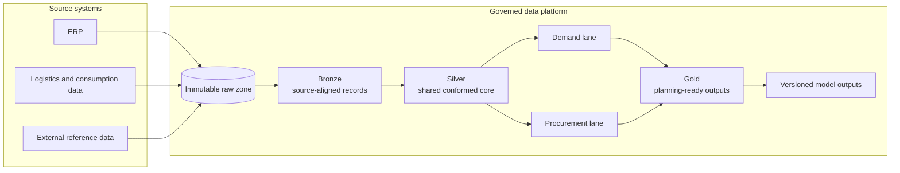
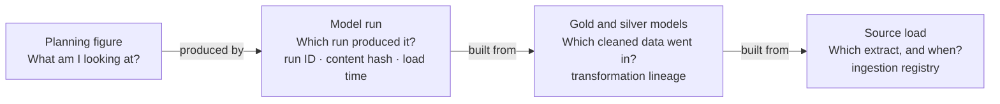

A forecast can look precise and still be difficult to trust.

That is especially true when the data behind it is spread across operational
systems, managed by different teams, and refreshed on different schedules. A
planner may have a number, but still not be able to answer the questions that
matter: Which source did it come from? Which model run produced it? Is it based
on the latest data? And does the procurement view use the same understanding of
the product, place, and time period?

Those questions sit at the centre of my ongoing work with a small consulting
team on a public-sector health-supply planning platform in Rwanda. The work is
deliberately described at a general level to respect confidentiality. It is not
a claim about client outcomes. It is a case study in the engineering choices
required to make analytical outputs dependable enough to inspect, discuss, and
use as decision support.

## Start with the seams, not the dashboard

The initial problem was not a shortage of information. It was that information
arrived in forms that did not naturally fit together: ERP transactions,
logistics and consumption records, external reference data, and outputs from
forecasting and supplier-intelligence work.

Each source had its own identifiers, level of detail, refresh rhythm, and
owner. Product codes and locations did not always mean the same thing across
systems. Forecasting and procurement analysis had also developed along separate
paths. That was understandable in the short term, but it made shared questions
harder in the long term. The same transformation logic could be recreated in
two places, and an apparently simple number could become difficult to trace
back to its inputs.

The useful question was therefore not, “Which dashboard should we build?” It
was, “What has to be true before a dashboard, model, or assistant is worth
trusting?”

For us, the answer started with a governed data foundation: one place where
source data could be retained, transformed deliberately, checked, and linked
to the analytical outputs built from it.

## A shared core before divergent questions

The platform is organised as a layered data flow. Source data first lands in an
immutable raw zone. It then moves through bronze, silver, and gold layers, with
quality checks and transformation logic applied at the appropriate point.

The most consequential design choice was to create a shared conformed core in
the silver layer. Product, location, date, pricing, and other common concepts
are reconciled once there. The demand and procurement lanes then only diverge
where their questions genuinely differ.

This sounds like a conventional layering pattern, but its value is practical.
The platform owns deterministic, shared work: typing, deduplication,
conformance, and common joins. Model owners retain the specialised judgement or
fuzzy logic that belongs in their models. Their outputs return to the platform
as versioned artefacts rather than becoming disconnected files or being
recreated by another team.

That division gives each team a clear responsibility. It also makes later
questions cheaper to answer. Instead of asking which of several pipelines a
number came from, a user can follow one lineage from a planning-ready output
through its model run and transformed data back to a source load.

## Treat model outputs as data products

One of the habits I brought to this work is that a model result should not be
treated as the end of a pipeline. A forecast or supplier score only becomes
useful to a broader organisation when it can be located, understood, and
compared alongside the operational information around it.

For that reason, the platform loads model outputs as versioned records with
run-level lineage. A selected run can be identified without pretending that it
is timeless, and a user can distinguish a current planning output from an older
one. This is a small but important shift: analytical work becomes part of the
same governed environment as the data that informed it.

Put together, that gives a planner a route back from any figure they are looking
at. Each step answers one question, and each answer comes from a record the
platform keeps, not from someone's memory of how the number was made.

_Illustrative. Each step names the record that answers its question. Tracing
individual rows back to the exact raw file they came from is still being
extended across sources._

The same principle guides data-quality work. Quality is not a final inspection
at the end of a project. It is built into ingestion and transformation through
freshness, completeness, uniqueness, valid-value, and pipeline-integrity
checks. When a source changes or a refresh is late, that needs to be visible
before it quietly changes the meaning of a downstream figure.

This does not make the data perfect. It makes the platform more honest about
what it knows, what it does not know, and where a user should look when a result
needs scrutiny.

## Engineering for a delivery that cannot wait for every dependency

The architecture also had to work within a real delivery environment. Access to
source data arrived through controlled extracts and periodic exports owned by
other teams. Model owners, infrastructure teams, and business validators all
held parts of the wider delivery path. Waiting for every dependency to resolve
before developing anything would have stopped the work.

Instead, we built deliberate seams. Ingestion and transformation patterns were
designed around clear source contracts. Model-output loaders made their lineage
requirements explicit. Where controlled access was still pending, safe sample
or snapshot-based workflows allowed logic and interfaces to be tested without
claiming that the work was complete.

That approach has two advantages. First, it lets engineering move without
turning temporary assumptions into hidden permanent dependencies. Second, it
makes blockers visible. A delayed extract, infrastructure change, or unanswered
data question is recorded as a delivery dependency with an owner, rather than
becoming an unexplained gap in the resulting application.

For me, that is as much a leadership practice as a technical one. The role has
included designing the platform and its pipelines, coordinating the data,
GenAI, and operational tracks, translating workshop discussions into tangible
delivery work, and maintaining a clear view of what is built, pending, or
dependent on another party.

## The foundation makes the next layer possible

The platform is still in progress. The shared core and demand-focused work have
been developed and tested, while other areas continue through their delivery
sequence. It would be premature to describe the platform as a finished
transformation or make performance claims. But the engineering direction is
clear: make the data lineage, quality checks, and model outputs visible enough
that people can reason about them.

That has a direct connection to the conversational assistant built alongside
the platform. An assistant is only as dependable as the evidence it can reach.
Once model outputs have a governed, traceable home, an interface can help a
planner explore them without treating a language model as a source of truth.

The companion article, [Grounded by Design: Building a Self-Hosted Assistant
for Health-Supply Planning](),
explains how I approached that next step: a deliberately narrow assistant that
can retrieve and explain governed outputs, while leaving calculations to the
backend and decisions to accountable people.

The broader lesson I am taking from this work is simple. Trust in an analytical
system does not begin when a forecast is displayed. It begins much earlier:
with the unglamorous work of reconciling identities, preserving lineage,
testing data, and making uncertainty visible.
