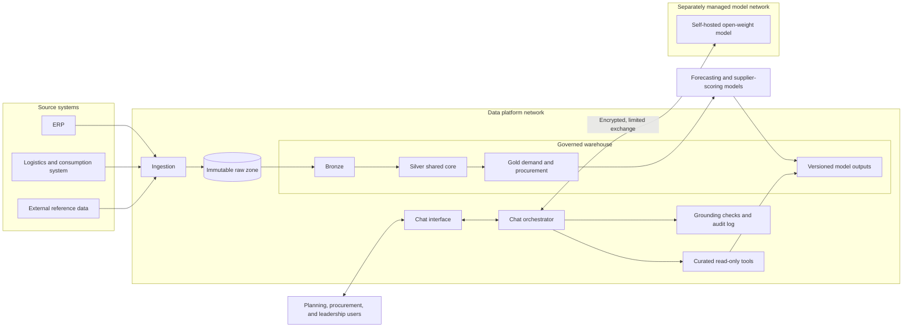

An assistant that cannot say “I don't know” is a risky thing to put next to a
planning decision.

That was the problem I kept returning to while working with a small consulting
team on a data and AI platform for a national public-sector health supply chain
organisation in Rwanda. Planners needed a more natural way to explore demand
forecasts, supplier information, and other outputs from the platform. But the
figures involved are consequential. A fluent answer with one invented number is
not helpful; it is worse than no answer at all.

The aim was therefore not to build an AI system that makes decisions. It was to
build a bounded assistant that helps people inspect what the platform already
knows. AI proposes; accountable people decide.

This is an ongoing engagement. The technical details below are deliberately
generalised, and the article describes work that has been designed, implemented,
or put through validation. It does not report client outcomes or performance
metrics.

## The context: useful answers need dependable foundations

The assistant sits on top of a governed data platform. That platform brings ERP,
logistics and consumption, and external reference data into one place, reconciles
them through a shared conformed core, and stores model outputs as versioned
records with run-level lineage. I cover how and why it was built in
[The Foundation Before the Forecast]().

For this article, the point is simpler. Because that foundation exists, a
question can be answered from governed, current outputs rather than from a static
document or a model's memory. That is what makes a grounded assistant possible
in the first place.

## A deliberately narrow architecture

The most important design decision was to keep the language model away from the
database.

The assistant does not receive open access to tables, and it does not generate
SQL. Instead, it can use a small set of curated, parameterised, read-only tools.
Those tools retrieve the relevant rows, apply the required filters or rankings,
and return structured results for the model to explain in plain language.

_Illustrative architecture. The organisation, systems, data, and figures are
generalised._

The chat orchestrator is the only component that talks to both the tools and the
self-hosted model. Database reads remain within the data-platform network. Only
the question, a limited set of retrieved rows, and the answer cross an encrypted
path to the separately managed model environment.

This was a better fit than fine-tuning, vector retrieval, or open text-to-SQL.
The data is structured, numeric, and refreshed as model runs change. Fine-tuning
would quickly become stale. Vector search is useful for unstructured knowledge,
but it is not a reliable way to calculate or compare current planning figures.
Open SQL would create a much larger accuracy and security surface than the use
case requires.

The trade-off is deliberate: the assistant can answer fewer kinds of question,
because each new question type needs a purposeful tool. In return, the answers
it does provide can be inspected and traced.

## Guardrails that travel with the data

The boundary is not just a prompt that asks the model to be careful. Each tool
returns the information needed to use its result responsibly.

For example, a result can carry rules that clarify the status of a score or how
missing information should be treated. The backend performs totals, comparisons,
and rankings; the model narrates the returned rows. After it drafts an answer, a
grounding check compares every number in that answer with the tool output. Each
turn also records the question, selected tools and arguments, answer, latency,
and grounding-check result in an audit trail.

The assistant can also refuse cleanly. When a question is outside its tool set,
it says what it cannot answer and suggests a question that it can. That is a more
useful failure mode than an answer that sounds plausible but cannot be verified.

There is an equally important boundary around explanation. The assistant can
describe what a forecast or supplier score shows. It does not claim to know why
a model produced a value when the underlying model has not supplied its drivers.
That distinction has prevented us from turning a conversational interface into a
false source of causal certainty.

## Building while access and infrastructure catch up

Like many public-sector delivery environments, access did not arrive all at
once. Data refreshes depended on controlled extracts owned by other teams, and
the GPU model server lived on a separately managed network.

Rather than waiting for every dependency to be resolved, I designed a few seams
into the system. The assistant can use either a file-based sample pack or the
warehouse through the same tool contract. Offline tests can exercise warehouse
readers against snapshots of model outputs without a live connection. The user
interface, prompt behaviour, and tool contracts can therefore be developed and
reviewed before every infrastructure dependency is ready.

The connection between the platform and model network was treated as delivery
work, not a background detail. We gathered structured connectivity evidence,
identified where traffic stopped, and turned an open-ended failure into a
specific change request for the network owner. The eventual encrypted link is
deployed as code and checked as part of the operational workflow.

This approach adds abstraction early. It also keeps progress from being held
hostage by a single delayed permission or network change.

## How we test a useful answer

For this kind of assistant, a conversational response should not be judged only
by whether it sounds natural. The question is whether a planning user can rely
on it for the limited job it is designed to do.

Our checks therefore include:

- Data-quality tests and freshness checks in the transformation layers.
- Pipeline-integrity checks for ingestion workflows.
- Offline tests for each assistant tool against model-output snapshots.
- Environment health checks and a first-tool smoke test.
- A scored question set where client validators ask real questions in their own
  words and assess whether an answer is correct, traceable, and useful.

The last point is particularly important. It keeps evaluation anchored in how
planners actually phrase questions, rather than only in examples written by the
engineering team.

## Where the work stands

The data platform, model-output loaders, conversational assistant, curated tools,
grounding check, audit trail, and delivery automation have been implemented.
The assistant has also been presented using current warehouse outputs during a
controlled validation session with client users.

There is still work ahead. The production-readiness plan covers sign-in and
role-based access, per-user history, request queueing to the GPU environment,
stronger identity on audit records, and a dedicated read-only data path. We are
also formalising a quality gate so that the scored question set can flag a drop
in faithfulness before a change is released.

Being explicit about those gaps is part of the design. A trustworthy system is
not one that claims to be finished early; it is one that makes its boundaries,
evidence, and next risks visible.

## What I am taking from the work

The interesting part of this project is not that it adds an LLM to a data
platform. It is the discipline of deciding where the model should stop.

The assistant is useful precisely because it is narrow: it can retrieve, explain,
and help users explore governed outputs, while leaving calculations to the
backend and decisions to accountable people. That is a pattern I expect to carry
into future AI systems: make the useful path easy, make the unsafe path hard,
and make the limits visible.
