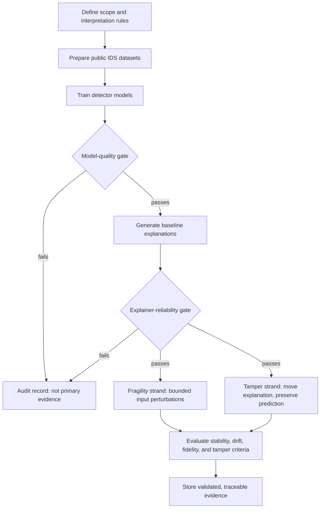

An explanation can make an AI decision easier to inspect. It can also create a
false sense of security.

That tension shaped my MSc research into explainable AI for intrusion detection.
When a system flags network activity as suspicious, a security analyst may look
at an explanation to understand which features influenced the prediction. But
what if the model's prediction stays the same while the explanation changes? An
analyst could be shown a convincing story about a decision without a dependable
way to know whether that story is stable.

My research asked a focused question: **can post-hoc explanations remain
dependable when an attacker can influence the input or deliberately redirect the
explanation?**

This article explains the benchmark I built to investigate that question and
summarises what it showed. The dissertation has been graded and formally
accepted. It has not been peer reviewed or formally published, so every result
below holds only for the conditions I tested.

## Explanations are an attack surface too

Intrusion detection systems classify network activity as benign or malicious.
Machine-learning versions of these systems can recognise patterns across many
traffic features, but their decisions are not always obvious to the analyst who
has to investigate an alert.

Post-hoc explainers such as SHAP and LIME try to make a single prediction more
legible. They assign an importance value to each feature, helping an analyst
inspect what the fitted model associated with that decision. That can be useful,
but it creates a second object that deserves evaluation: the explanation itself.

I did not treat explanation robustness as one broad property. The benchmark
separates three questions that are often blended together:

1. **Is the underlying detector good enough to evaluate?** A weak or unstable
   classifier makes a robustness result difficult to interpret.
2. **Does an explanation change under a bounded input perturbation?** This is
   explanation fragility: the explanation may shift as the input changes,
   whether or not the prediction is preserved.
3. **Can an explanation be deliberately redirected while the prediction is held
   fixed?** This is targeted tampering. The decision remains the same, but the
   explanation presented to the analyst is pushed away from the feature it
   originally emphasised.

The distinction matters. An explanation that is sensitive to ordinary
perturbation is not automatically easy to manipulate in a targeted way, and a
stable-looking explanation is not automatically reliable.

## A benchmark, not a striking example

It is easy to demonstrate one unexpected explanation. It is much harder to
create an experiment where another person can see exactly what was varied, what
was held fixed, and how the evidence was produced.

I therefore built a configuration-driven benchmarking framework around two
established public intrusion-detection datasets: CICIDS2017 and UNSW-NB15. Both
contain labelled records of benign and malicious network traffic, but they have
different feature schemas, traffic sources, and attack categories. Using both
does not make the results universal; it provides a bounded check across two
distinct experimental settings.

The framework evaluates two common model families: XGBoost, a tree ensemble,
and a multi-layer perceptron. It then applies two widely used post-hoc
feature-attribution methods with different mechanisms: TreeSHAP, an exact SHAP
algorithm for tree models, on XGBoost; and LIME, a sampling-based method, on
both models. The goal is not to crown a universally safer model or explainer. It
is to test specified model--explainer pairings under the same documented
conditions.

This choice shapes how the results can be read. LIME can support a
bounded, architecture-associated comparison because the same explainer is used
with both models. TreeSHAP is specific to the tree model. A model-agnostic SHAP
approximation was evaluated separately as a reliability control, not used to
turn the SHAP comparison into a cleaner architecture claim.

The diagram is deliberately more important than it looks. The two gates stop a
poor detector or unreliable explainer from silently becoming evidence about
robustness. A failed configuration remains an audit record; it is not quietly
deleted or allowed into the primary analysis. An experiment should not answer a
sophisticated question with a measurement tool that has not first earned that
role.

## Two related, but different, attack strands

The first strand measures **fragility**. It applies bounded, loss-directed
perturbations inspired by fast-gradient and projected-gradient approaches. The
aim is to observe how the explanation responds to a controlled input change. A
prediction may change in this strand; prediction retention is recorded as a
diagnostic rather than used to filter inconvenient cases away.

The second strand measures **tamper resistance**. Here the optimisation target
is not simply the detector's loss. It is the explanation. The benchmark tries to
reduce the apparent importance of the feature that the baseline explanation
ranked highest, while preserving the detector's prediction.

This gives the research a concrete analyst-facing interpretation: could a
decision remain “malicious” while the explanation no longer draws attention to
the characteristic that originally appeared most important?

## A deliberately bounded threat model

The threat model is query-based. It assumes that an attacker can submit a
modified input, observe the detector's probability output, and obtain an
explanation for that input. It does not assume access to model weights,
gradients, training data, architecture, or explainer internals.

Access to the explanation interface is an explicit experimental assumption, not
a claim about every deployed intrusion-detection system. In practice,
feasibility would also depend on which interfaces are exposed, authentication,
rate limits, monitoring, and the difficulty of introducing a modified network
flow.

This boundary also keeps the comparison fair. The tree model and neural network
have different internal structures, but they share the same external
experimental interface. A gradient-free optimisation method, simultaneous
perturbation stochastic approximation (SPSA), lets the benchmark
apply one consistent attack formulation across both model families without
silently giving one of them a more powerful adversary.

## Reproducibility is part of the method

For this research, reproducibility was not an appendix task. It shaped the
framework itself.

The data pipeline fits preprocessing transformations on training data only,
then applies them unchanged to held-out test data. It removes identifiers and
shortcut-prone fields that could make an intrusion detector appear stronger for
the wrong reason. The test cohort used for attack evaluation is frozen with a
documented random seed, so later stages are comparing the same records rather
than a moving sample.

Each experiment is defined through configuration rather than hidden notebook
state. A validated configuration specifies the dataset, model, explainer,
attack, metrics, seed, and output location. This gives each run a clear contract
before data is loaded or a model is trained.

The implementation follows the same separation of concerns. A runner
coordinates data preparation, model training, explanation extraction, attacks,
and metrics. A component registry lets a named dataset, model, explainer,
attack, or metric be selected through that configuration. The resulting record
captures the resolved settings, seed, artifacts, and provenance needed to
reproduce or audit a run. Automated checks validate configurations,
preprocessing, model outputs, explanations, attacks, metrics, and result
structure.

That discipline became especially important for explanation methods that include
sampling or approximation. A result cannot be called robust merely because one
run appears stable. The benchmark therefore distinguishes a method's own benign
variation from changes associated with the attack condition.

## What the benchmark measures

The evaluation does not rely on a single visualisation or a single score. It
uses complementary checks:

- **Rank stability:** whether influential features remain similarly ranked.
- **Attribution drift:** how far the explanation vector moves.
- **Fidelity:** whether a reported attribution remains meaningfully connected to
  the model behaviour under a defined intervention. I treat this as an
  auxiliary check, because deleting or inserting features can itself create
  unrealistic inputs.
- **Tamper criteria:** whether a targeted feature has been displaced while the
  model decision remains intact.

These metrics answer different questions. A familiar-looking top feature list
does not guarantee that attribution magnitudes are stable. A changed attribution
does not prove a decision has changed. And a method that varies because of its
own approximation process needs a different interpretation from one that varies
because an input was attacked.

For targeted tampering, the benchmark separates the attack objective from the
assessment. The attack tries to suppress the feature the baseline explanation
ranked highest. The assessment then checks whether that feature was actually
displaced while the prediction remained fixed, alongside the broader stability
and fidelity measures. This makes it harder to confuse optimising one score with
demonstrating a meaningful explanation change.

## What the benchmark found, within the tested conditions

The final evidence base is 126 validated, condition-level results: two
datasets, three model--explainer pairings, two attack strands, and three
repeatability seeds. Every included detector met the quality gate, with
attack-class recall and F1 of at least 0.80.

- **TreeSHAP explanations were highly fragile.** Under the standard
  perturbations, mean cosine drift between clean and attacked explanations was
  0.95 on CICIDS2017 and 0.72 on UNSW-NB15. On this scale, 0 means no change
  and a value near 1 means the explanation became unrelated to the original.
- **LIME looked stable, but that is not evidence of robustness.** Its raw drift
  was small. However, in none of the 72 LIME fragility conditions was the attack
  drift distinguishable from LIME's own run-to-run noise. Any attack effect, if
  present, could not be separated from the method's sampling variation.
- **LIME stability differed by model.** With LIME held fixed, feature rankings were more
  stable on the neural network than on XGBoost. This is an association within
  the tested conditions, not a causal claim about architectures.
- **Targeted tampering worked, but not everywhere.** For TreeSHAP on
  UNSW-NB15, the attack pushed the originally most important feature out of the
  top ten in 20.3% of flows (95% CI 18.3--22.3%), while the prediction stayed
  the same. On CICIDS2017, the same pairing barely moved (0.1%). LIME showed
  some movement in the tamper runs, but again it could not be separated from
  LIME's own noise.

That last contrast is the most useful one. On CICIDS2017, the ordinary
perturbations flipped almost every prediction and moved the TreeSHAP
explanations a great deal. Yet the targeted attack, which had to keep the
prediction fixed, barely moved them. Fragility and tamperability are not the
same property.

The reliability gate also did its job. I tested KernelSHAP, a model-agnostic
approximation of SHAP, as a cross-check on the TreeSHAP results. It passed a
small calibration run but failed the reliability gate at full scale, with
500 flows per run: seven of nine completed runs exceeded the pre-set limit on drift between repeated explanations of the
same input. I did not relax the limit after seeing the result. KernelSHAP is
reported as an explainer-reliability finding, not as robustness evidence, and
the SHAP results stay confined to TreeSHAP on XGBoost.

The central result is that three properties need separate tests: whether an
explainer is numerically reliable, how fragile its explanations are, and how
easily they can be deliberately redirected. Passing one test says little about
the others.

## Deliberate limits

This is a controlled robustness experiment, not a simulation of every real
network adversary. The perturbations are experimental stimuli, not claims about
physically realisable network flows. The threat model assumes the attacker can
query the explanation, which not every deployment allows. The perturbation
budget is defined in normalised feature space, so it is comparable within a
dataset but not directly across datasets. The research is limited to the public
datasets, the tested model--explainer pairings, the defined budgets, and the
evaluation choices in the benchmark.

Those limits are not a weakness to hide. They describe the boundary inside which
the experiment can make a defensible contribution. The aim is to make claims
that are precise enough to test, revise, and reproduce—not to make explainable
AI look settled before it is.

## The wider lesson

The work has changed how I think about explainability in applied AI. An
explanation should not be treated as a decorative layer added after model
validation. It is part of the system a person may rely on, and it needs its own
reliability checks, threat model, and evidence trail.

That is also why this research connects naturally to my engineering work. In a
data platform or AI product, trust is not created by displaying more detail. It
comes from being explicit about what a system can support, how that support was
tested, and where the evidence stops.

The benchmark code, configurations, and reproduction steps are on GitHub:
[xai-ids-robustness](https://github.com/cliffordEmmanuel/xai-ids-robustness).

For a plain-language introduction to the two explanation methods, see
[What SHAP and LIME Explain—and What They Do Not]().
